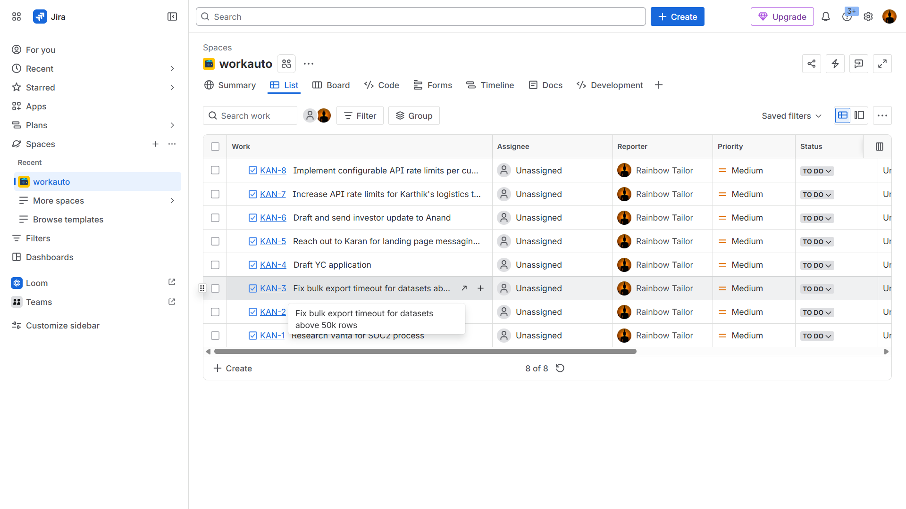
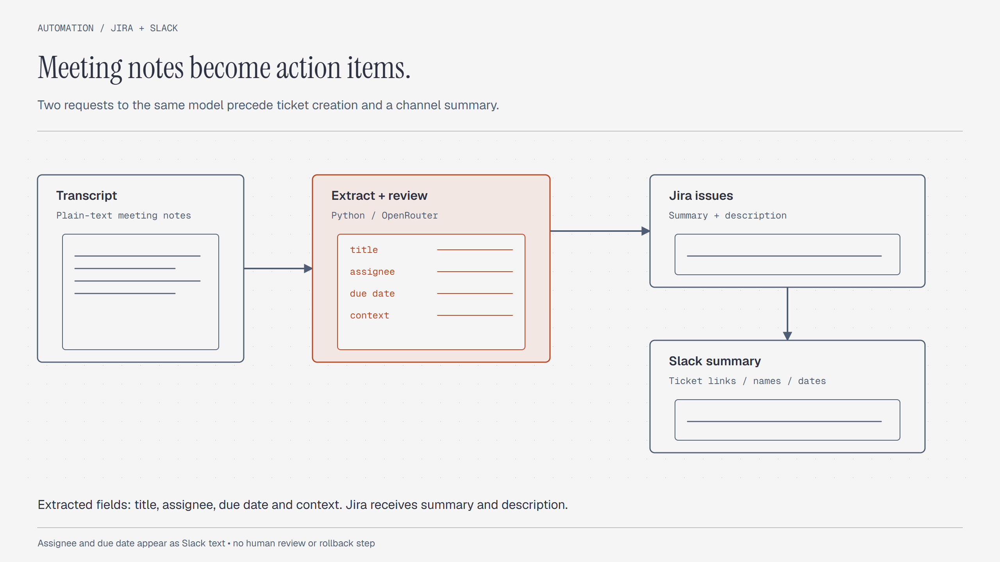
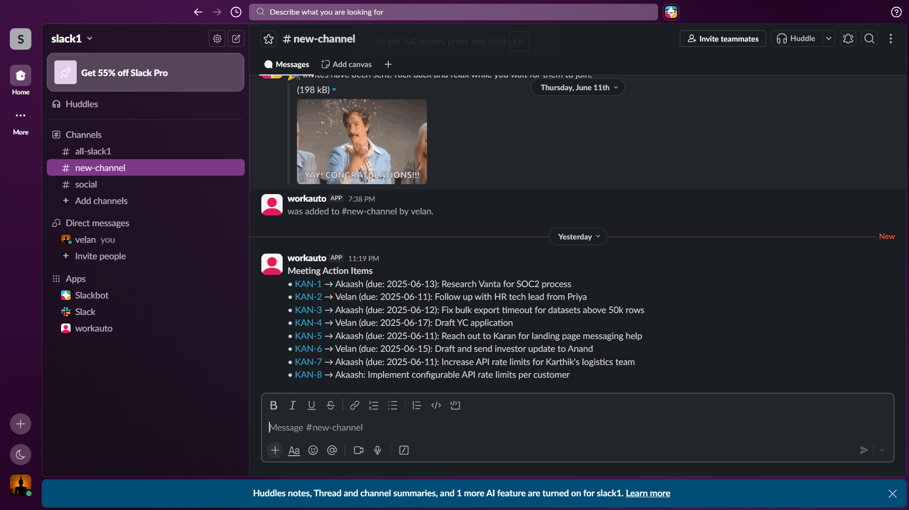

# Jira–Slack AI Automation

Convert meeting action items into Jira tasks and a Slack summary. A Python script reads a transcript and requests structured actions from OpenRouter.



## Execution flow



1. Read the transcript file.
2. Ask the configured model to extract action items.
3. Ask the same model to review its JSON response.
4. Create one Jira task for each returned item.
5. Post a Slack message with ticket links, names, and due-date text.

The second request uses the same configured model. It is not an independent model check.
The script creates Jira tasks immediately after parsing the response.

## Configuration

Install the imported Python packages:

```sh
python -m venv .venv
# Activate the environment before the next command.
python -m pip install requests slack-sdk
```

Configure these values in a local copy of `main.py`:

| Setting | Required value |
|---|---|
| `WebClient(token=...)` | Slack bot token, replacing `API1` |
| `jira_base` | Your Jira workspace URL |
| `email` | Jira account email |
| `token` | Jira API token, replacing `API2` |
| `jira_project` | Target project key |
| `slack_channel` | Channel identifier accessible to the bot |
| `or_key` | OpenRouter credential, replacing `API3` |

The script reads these values directly from source. It does not currently read environment variables.
Keep credentials out of commits. Use a Slack bot with permission to post messages and a Jira account that can create tasks.

## Run

```sh
python main.py transcript.txt
```

This command sends the transcript to OpenRouter, creates Jira issues, and posts to Slack.
Use a test project and channel for the first run. Repeated runs can create duplicate issues.

The action schema contains `title`, `assignee`, `due`, and `context`.
The Jira request sets the project, summary, description, and issue type.
It does not set Jira's assignee or due-date fields. Names and dates appear in the Slack summary instead.

## Output example



These screenshots record an earlier run. They do not prove that the current credentials, model, or service configuration works.

## Files

| File | Purpose |
|---|---|
| [main.py](main.py) | Extraction, Jira creation, and Slack delivery |
| [transcript.txt](transcript.txt) | Sample meeting transcript |
| [summary.pdf](summary.pdf) | Original approach and proposed improvements |
| [Screenshot (38).png](Screenshot%20%2838%29.png) | Additional demonstration image |
| `jira_output.png`, `slack_output.png` | Recorded service output |

## Current limits

The configured model is `google/gemma-4-31b-it:free`. Check its availability before use.
The script expects valid JSON and does not provide a review screen, retries, or duplicate detection.
It does not roll back created Jira tasks after a later failure.
It prints provider responses, which can contain transcript details.

This documentation update did not execute external Jira or Slack actions.

## License

[MIT](LICENSE) covers original script and documentation contributions by Velan E.
See [LICENSING.md](LICENSING.md) for sample content, screenshots, and service terms.
